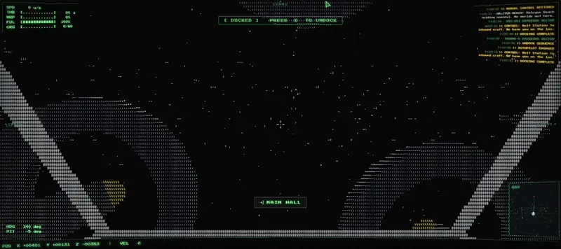

<h1 align="center">Hi there 👋</h1>

I'm a self-taught AI engineer. On my own I build on-device speech models and the SDK that runs them; by day I design complex agentic systems that run in production.

---

## Projects

### 🎙️ Alkove

**Alkove** is an on-device voice SDK: voice isolation, wake words, voice activity and voiceprints, in the browser (WebAssembly), in Python and on Android, with plugins for LiveKit Agents, Pipecat and Home Assistant. No server, no key. I train the models and wrote the inference engine they run on, one Rust core; code and weights under Apache-2.0.

👉 [Try it on your voice](https://alkove.ai/#demo) · [Models on Hugging Face](https://huggingface.co/alkove-ai) · [GitHub](https://github.com/alkove-ai/alkove)

---

### 🌿 Brindille

**Brindille** (French for “twig”) is a French text-to-speech model with 93,734 parameters that runs entirely in the browser: text in, 22.05 kHz audio out. No vocoder: the network predicts pitch, voicing and spectral envelopes, and a harmonic + noise synthesizer renders the waveform. The whole page, engine included, weighs 2.7 MB and speaks at ~75× real time on one thread. It runs on the Alkove engine.

👉 [Try the demo](https://huggingface.co/spaces/edbrdi/brindille) · [Model on Hugging Face](https://huggingface.co/edbrdi/brindille)

---

### 🚀 Spascii

**Spascii** is a slow space-flight exploration game drawn in glowing ASCII. The part I care about: you talk to the crew in your own words, and there is no LLM behind it. An embedding model routes what you type to what the character can answer, so the conversation stays free-form, runs on your machine and never leaves it. The music writes itself as you fly, and every outpost remembers how you treated it.

👉 [Play the game](https://subtle-cobbler-738f09.netlify.app/)
