
<a href="#-"><picture><source media="(max-width: 600px)" srcset="assets/profile/hero-m.40d539f2.svg"></picture></a>

<a href="#-"><picture><source media="(max-width: 600px)" srcset="assets/profile/pipeline-m.987423ea.svg">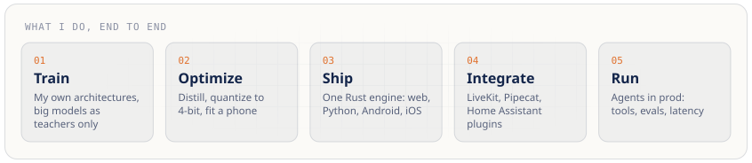</picture></a>

<a href="#-"><picture><source media="(max-width: 600px)" srcset="assets/profile/assistant-m.8fa4cf28.svg">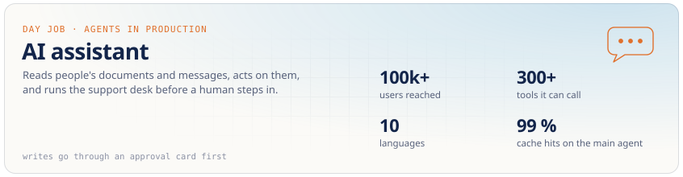</picture></a>

<!--video:podcast-->

https://github.com/user-attachments/assets/99cae349-d7d8-499c-acff-8a4590f356a3

An excerpt of a weekly podcast written and voiced by AI from a company's own content. Sound on.

<a href="https://alkove.ai"><picture><source media="(max-width: 600px)" srcset="assets/profile/alkove-m.d7e5f12f.svg">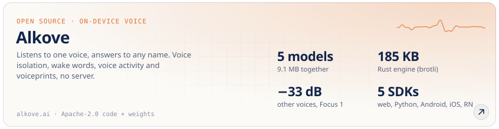</picture></a>

<a href="https://huggingface.co/alkove-ai"><picture><source media="(max-width: 600px)" srcset="assets/profile/models-m.849da55c.svg">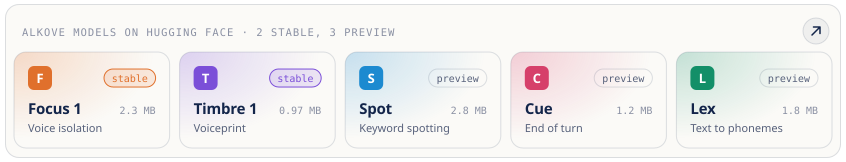</picture></a>

<!--video:alkove-demo-->

https://github.com/user-attachments/assets/37dd5b70-eee4-4713-8dc7-6424bd54b6f1

Alkove on the site demo: music and two voices, then voice A only, then voice B only. Sound on.

<a href="https://huggingface.co/spaces/edbrdi/brindille"><picture>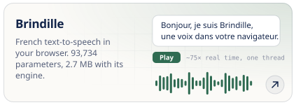</picture></a><a href="https://subtle-cobbler-738f09.netlify.app/"><picture>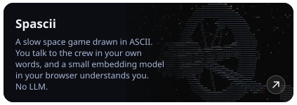</picture></a>

<a href="https://github.com/edbrdi/agent-redteam"><picture>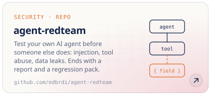</picture></a><a href="https://dev.to/edbrdi/can-a-plain-table-hijack-an-ai-agent-2pde"><picture>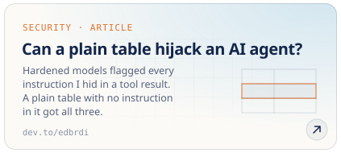</picture></a>

Latest on the Alkove blog

<a href="https://alkove.ai/blog/voice-agent-anatomy/"><picture><source media="(max-width: 600px)" srcset="assets/profile/blog-1-m.e07820f1.svg">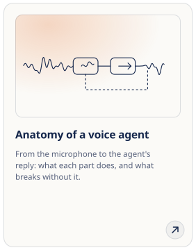</picture></a><a href="https://alkove.ai/blog/perceived-latency/"><picture><source media="(max-width: 600px)" srcset="assets/profile/blog-2-m.78a16db8.svg">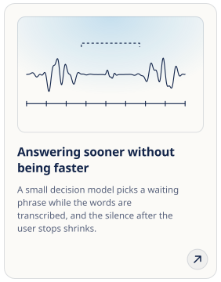</picture></a><a href="https://alkove.ai/blog/typed-wake-word/"><picture><source media="(max-width: 600px)" srcset="assets/profile/blog-3-m.3c5aa6dc.svg">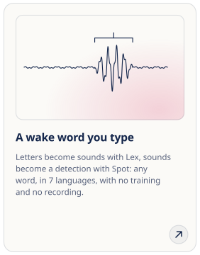</picture></a>

